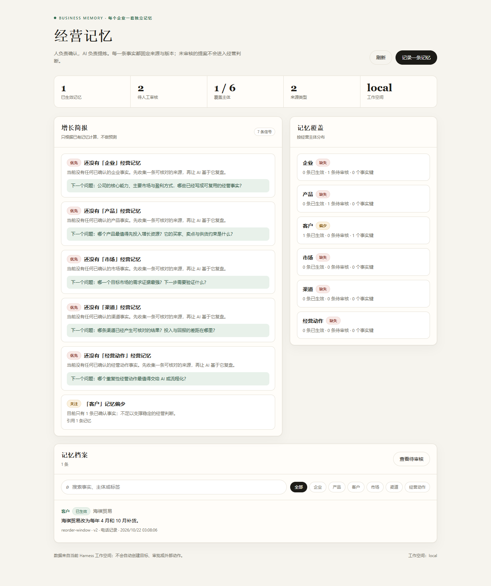

# 企业经营记忆：每个企业一套独立的经营记忆

日期：2026-10-22
分支：`codex/business-memory-20261022`
基线：`codex/product-library-20261022`（`6e64498`）
工作树：`workspace-agent-memory/`（独立 worktree，避免与产品库/企业资料库线程互相覆盖）

## 这次做了什么

围绕“人负责确认，AI 负责提炼”落了一整套经营记忆区域：

1. **Harness 插件** `plugins/workspace-business-memory`
   - 每个工作空间（企业）一套独立记忆，按 `ctx.workspace` 分区；
   - 主体（企业/产品/客户/市场/渠道/经营动作）+ 事实键 + 类型 + 来源 + 版本链；
   - 模型只能提出 `proposed` 候选，管理员审核后才变 `active`；
   - 可核对来源按精确版本/SHA 校验收（先接产品资料库）；
   - 增长简报由已确认记忆确定性计算，所有信号引用记忆 id。
2. **组合接线** `harness.local.yml`
   - 新增 `workspace`（企业成员/角色）、`audit`（元数据审计）与
     `business-memory` 三行；
   - `productLibraryBaseURL` 指向本地 product-library，使 product-page 来源可核对。
3. **记忆区域页面** `GET /business-memory`
   - 自包含 HTML（严格 CSP、无外部资源、无构建步骤）；
   - 概况、增长简报、覆盖、检索、详情、审核、撤回、手工记录。
4. **DSH 适配器** `integrations/dsh-business-memory`
   - 6 个工具：`business_memory_status/map/brief/recall/read/propose`；
   - 写入只创建待审核候选，**不暴露审核/撤回工具**；
   - 已安装到当前 DSH profile，并在本会话真实调用验证。
5. **可复现验证**：单元/插件/DSH 适配器测试、组合 doctor、本地 HTTP 冒烟、
   区域截图。

## 产品逻辑：记忆如何驱动增长

```
经营对话 / 资料 / 产品页
        │  (模型只读到已授权内容)
        ▼
business_memory_propose   →   proposed 候选（不可用于回答依据）
        │
        ▼  人在 /business-memory 审核
   active 事实（固定来源、版本、核对状态）
        │
        ├─ business_memory_recall → 后续对话用企业自己的事实回答
        ├─ business_memory_map    → 看清哪些经营主体还没有记忆
        └─ business_memory_brief  → 覆盖缺口 / 待审核 / 将过期 / 未复盘决策
                                      └─ 每个信号引用记忆 id；不预测收益
```

“LLM 驱动增长”在这里不是让模型编造增长结论，而是：

- 模型把对话里出现的**可复用事实**沉淀成候选，减少每次从零解释业务；
- 模型回答前先 `recall`，让建议建立在企业已确认的事实上；
- 简报告诉模型“还缺哪类事实、哪个决策没有结果”，把下一轮对话引向真正的
  经营问题，而不是泛泛而谈；
- 所有候选都要人确认，模型不能自己把猜测变成事实。

## 数据模型

一条记忆：

| 字段 | 说明 |
| --- | --- |
| `subjectType` / `subjectId` / `subjectLabel` | 企业、产品、客户、市场、渠道、经营动作 |
| `factKey` | 稳定事实键，如 `moq`、`lead-time`、`buyer-profile` |
| `kind` | fact / observation / hypothesis / preference / decision / outcome |
| `statement` / `detail` | 可核对的事实正文与补充 |
| `source` | `operator` / `conversation` / `product-page` / `document`，含引用、核对状态、SHA-256、依据 |
| `status` / `lifecycle` | proposed / active / rejected / superseded / revoked，读取时计算 expired |
| `revision` / `previousId` / `history` | 事实代际、替代链与完整审计历史 |
| `proposedBy` / `reviewedBy` / `activatedAt` | 提出者、审核者、生效时间 |

不变量：

- 同一工作空间、同一主体、同一事实键最多一条 active；
- active 必须有审核人与生效时间；proposed 不能带审核回执；
- 外部来源在写入和审核时都重新核对；版本/哈希不符直接拒绝；
- 任何损坏、重复 active、跨企业记录、超限数据都 fail closed，不静默重置。

## 企业隔离

- `ctx.workspace.resolve(actor)` 解析企业身份与成员角色；未知企业/成员返回
  `HARNESS_WORKSPACE_FORBIDDEN`；
- 存储按 `state.workspaces.<workspaceId>.harnessBusinessMemory` 分区；
- 角色来自成员表，请求头自报的 `admin` 不会提权；
- 单元测试用同一服务实例写入两个 workpace，验证同一事实键互不可见、跨企业读取
  返回 404。

## HTTP 与工具

HTTP：

```text
GET  /api/business-memory/status
GET  /api/business-memory/map
GET  /api/business-memory/brief
GET  /api/business-memory/records?q=&subjectType=&subjectId=&factKey=&kind=&status=&limit=
GET  /api/business-memory/records/:id
POST /api/business-memory/records
POST /api/business-memory/records/:id/review
POST /api/business-memory/records/:id/revoke
GET  /business-memory
```

组合内工具：5 个只读 + 3 个需要一次性审批票据的写工具。
DSH 工具：5 个只读 + `business_memory_propose`；没有审核/撤回。

所有写操作带 `requestId` 幂等；DSH 的 `business_memory_propose` 用参数哈希生成
确定性 requestId，重试不会产生重复候选。

## 验证

以下均为本地、合成输入，不是生产 Host/真实模型/真实企业数据验收。

| 项 | 结果 |
| --- | --- |
| `node --test plugins/workspace-business-memory/test/domain.test.mjs plugins/workspace-business-memory/test/plugin.test.mjs integrations/dsh-business-memory/test/index.test.mjs` | **35/35 通过**，0 失败，0 跳过（证据 `tests.tap`） |
| `wh doctor --composition harness.local.yml` | 退出码 0；9 条 memory 路由、workspace/audit seam 与 8 个工具注册成功 |
| `node scripts/business-memory-smoke.mjs --out …/smoke.json` | **23/23 通过**；真实 HTTP：提出→审核→替代→召回→简报→拒绝无依据→拒绝未知成员 |
| 区域页面截图（Edge/Playwright） | 5 张，`consoleErrors: []`；概况、详情、编辑、待审核、审核后 |
| 区域页面审核（真实点击） | 在待审核列表打开提案并点击「通过并生效」：active 1→2、proposed 2→1，页面无错误（`area-approved.png`） |
| DSH 工具在线验证 | 已安装 `@local/dsh-business-memory`；本会话实际调用 status/recall/brief/propose；新候选 `e29a4336-…` 以 `proposed` 落库 |

证据目录：`docs/validation/business-memory-harness-20261022/`
（`tests.tap`、`smoke.json`、`dsh-tools.json`、5 张 png）。



## 怎么用

```powershell
$node = "C:\Users\Administrator\.dsh\dsh-runtimes\dsh-primary-runtime\dependencies\node\bin\node.exe"
cd workspace-agent-memory
& $node scripts/harness-serve.mjs
# 浏览器打开 http://127.0.0.1:8790/business-memory
```

DSH 工具读取同一个 origin（`BUSINESS_MEMORY_BASE_URL` 可覆盖）。
启动 Harness 后，在当前会话里就可以：

- “我记得海祺的补货节奏吗？” → `business_memory_recall`
- “现在经营记忆还缺什么？” → `business_memory_brief`
- “把刚才确认的买家画像记下来” → `business_memory_propose`（进入待审核）

## 未完成 / 明确边界

- **真实企业资料库来源尚未接线**：`document` 来源接口已预留，但企业资料库线程
  的服务契约还没定稿；当前明确返回未配置，不降级为本地抽取。
- **真实产品库核对**只有合成 Medusa 校验过；本地 product-library 未配置真实
  Medusa source，因此 product-page 来源在本地会以“页面不存在”失败关闭。
- 没有客户可见披露、多租户 SaaS、角色管理 UI、通知、定时复盘或自动清理；
- 没有向量检索/Mem0；召回是结构化过滤 + 子串搜索；
- 区域页面是单文件 HTML，不是组件化前端；移动端只做了基础响应式；
- 真实模型质量、真实企业数据、生产 Host 的并发/断网/重启演练均未执行。

## 合并方式

本次工作在独立 worktree 的 `codex/business-memory-20261022` 分支，未改动
`workspace-agent` 当前分支。合并：

```powershell
$git = "C:\Program Files\Git\cmd\git.exe"
cd workspace-agent
& $git merge codex/business-memory-20261022
```

或者直接评审 worktree 中的 diff。合并后重新安装
`integrations/dsh-business-memory` 即可让 DSH 工具指向主工作树。
