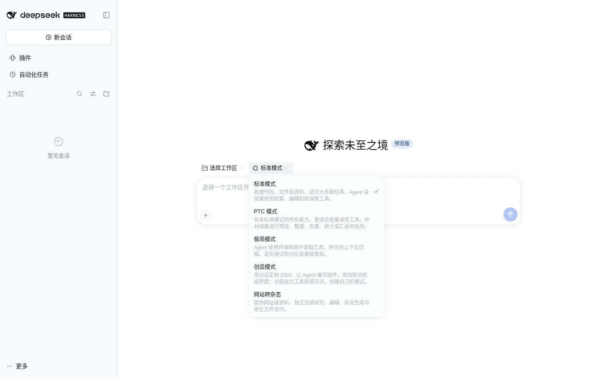
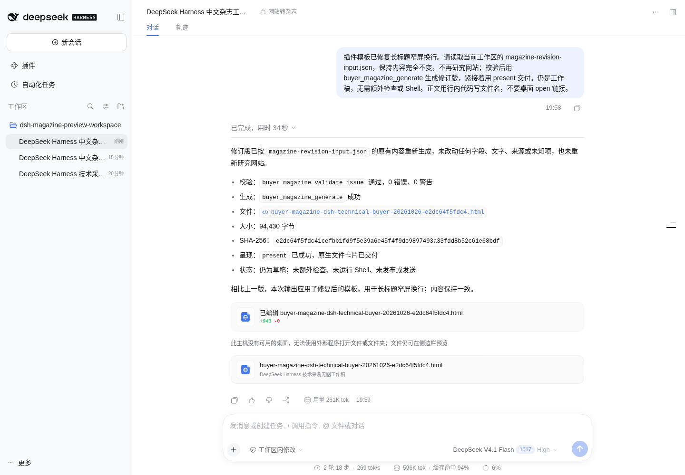
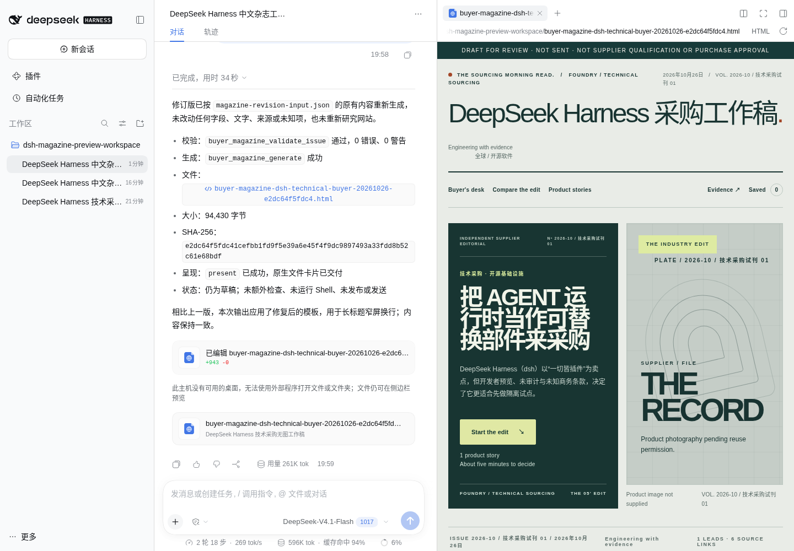
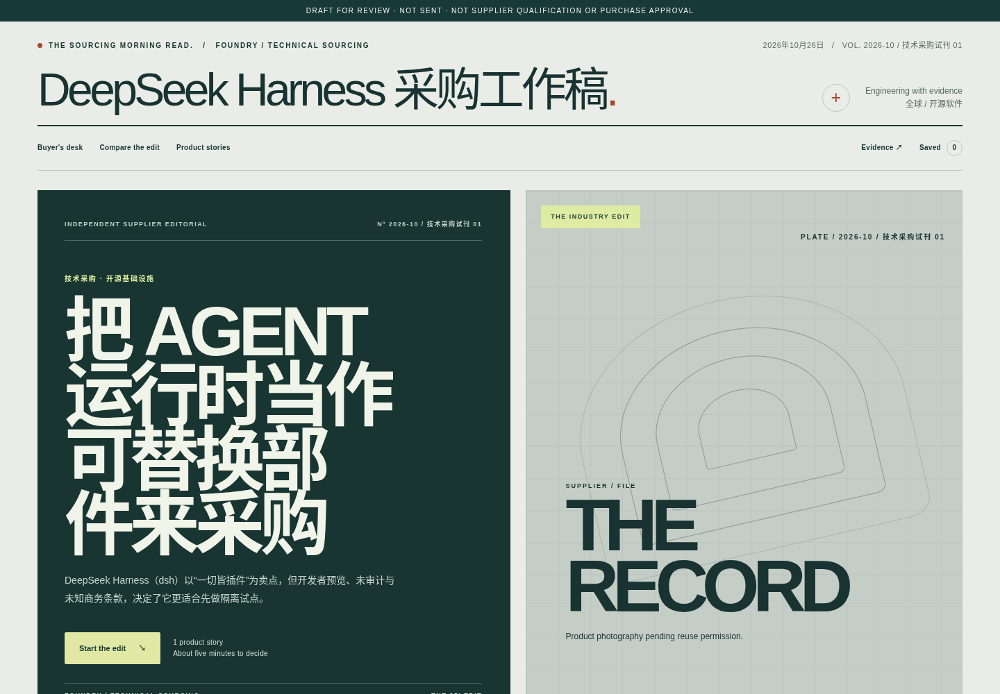
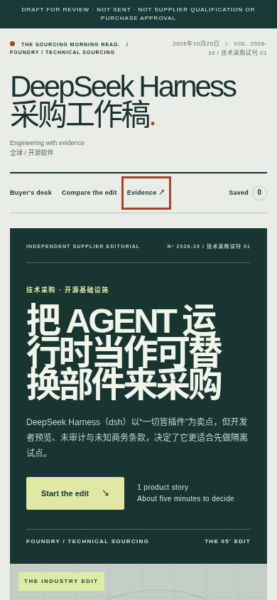
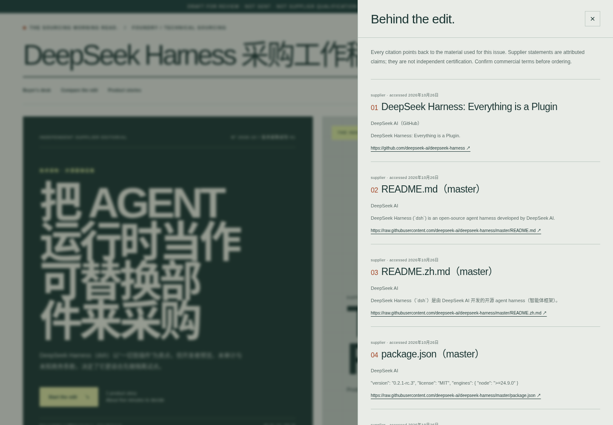
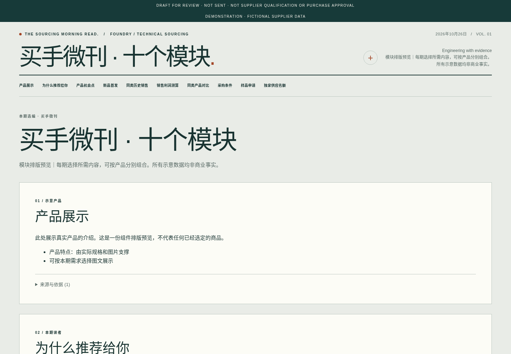
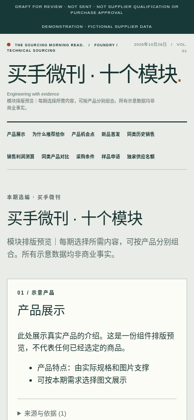

# 独立网站转杂志插件与渲染统一

2026-10-27（中国标准时间）。用户要求把原网站转杂志和后续模块化微刊合为可独立完成任务的插件。本轮以 `codex/dsh-enterprise-join-20261026` 的 `faed6a99` 中原生杂志包为基础，仅引入该包；没有合并其他业务系统或恢复旧宿主。

## 使用方式

插件为 `dsh-buyer-magazine@0.2.0`。独立安装后，在 DSH 原生新会话的模式选择器选择「网站转杂志」，选定工作区与宿主已有模型，然后提供网址及读者要求。Agent 自行研究、编辑、组装输入、校验、生成并通过原生文件卡片交付；用户无需编写 JSON 或手动运行脚本。

包内包含 Agent 预设、唯一的 `buyer-magazine` Skill、原 Studio 方法与 18 份参考资料、四种主题、十种模块、编译器、文件生成工具和可选 ERP 适配器。Sourcing、资料库、ERP 均不是安装或执行的前置条件。模型凭据和网络访问沿用宿主配置。

独立预设使用原生网页与文件工具，不提供 Shell／PowerShell 执行入口。生成器已回读实际文件并核对哈希；常规验收不应再申请更高权限执行 ls、grep 等重复检查。发布与发送仍按用户授权执行。

## 重复实现如何收敛

| 部分 | 当前归属 |
| --- | --- |
| 网站编辑、产品档案、来源、四种主题与交互 | 原 Studio 核心，位于 `dsh-buyer-magazine/upstream/` |
| 十种模块的语义、贡献利润与来源口径 | `dsh-buyer-magazine/src/modules/` |
| 原模块 JSON | 输入适配器转成同一 Studio schema 的 `composition: modules`；不编造产品档案、网址或采集时间 |
| ERP 只读快照 | 同包适配器转换所选 blocks；内部 provenance 不进公开 HTML |
| HTML 校验、主题外壳、编译与原生写入 | 同一条编译／生成链路 |
| Sourcing 的原微刊 Skill 与脚本 | Skill 直接复用独立包；原脚本路径保留薄转调，原独立文档渲染器已移除 |

网站稿与模块稿支持相同的四种主题。兼容模块输入补充了公开 HTTPS、图片复用声明与实际产品图限制；不满足要求时明确报错。原 Studio 的价格、来源与原生文件边界继续保留。

## 验证与实际产物

本轮结果：

- 与同期 ERP Admin 更新整合后，`npm run check`：223/223、零失败、零跳过；六组 Client 冒烟通过，既有 React act／Space 重复 key 警告仍在。
- 实际 `npm pack` 产物通过官方 CLI 安装到独立 Web profile。该 profile 仅安装一个自研包 `dsh-buyer-magazine`；没有 Sourcing、ERP、资料库或品牌插件依赖。
- 官方 SDK：一个完整 Skill 可被原生文件发现器读取；23 份 Studio 原始资源指纹保持；12 次原生工具 dispatch、创建文件、相同内容复用及官方 present 事件通过。此项为合成夹具，不冒充真实模型执行。
- 实际模型：DeepSeek-V4.1-Flash 在原生 Web 中完成一个网址任务，13 个模型步骤、20 次原生工具调用。10 次网页获取包含失败后的重试，实际采用 6 条公开来源。校验两次、生成一次、官方 present 一次，持久会话记录包含 `deliverables/presented` 和 `turn/end`；Shell 调用与审批请求均为 0。
- 实际生成文件为 94,216 字节，与同一输入的核心编译结果一致，没有手工替换 HTML。原生文件卡片可打开侧栏 HTML 预览，实际 iframe 中能读到该稿标题。
- 最后检查发现长中英混排刊名在手机宽度溢出，已修复原主题的 nowrap 规则；Agent 用内容不变的原期号生成并交付修订版。实际网站稿和十模块稿在 1440／390px 下均无页面横向溢出、无 JavaScript 错误、无外部资源请求；实际来源弹窗可打开。四种主题与十模块组合另有核心回归。

最终独立压缩包为 `dsh-buyer-magazine-0.2.0.tgz`，113,325 字节、58 个发布文件。安装／发现检查明确使用打包文件；最后一次更新采用新的本地包路径，避免包管理器复用同路径的旧缓存。

本轮独立 profile 位于 `/workspace/dsh-magazine-preview-home`，只监听 `127.0.0.1:3081` 且保留官方认证。此前品牌联合预览也已按需安装这个包，当前仓库提供八个可选原生插件。

### 独立安装的原生 Agent 入口

### 真实网站任务生成的杂志

输入为 DeepSeek Harness 的公开 GitHub 项目。测试明确要求面向技术采购者、中文、一个产品、无图文字版与 HTML 工作稿；没有提供示例事实或预制的期号 JSON。

云主机没有桌面程序时，使用文件卡片上的「在侧边栏预览」按钮；这项原生 HTML 预览已实际打开并检查标题。

### 同一核心渲染的十模块示意

以下是明确标注的合成排版测试，金额与权益不代表真实业务。用于验证模块组合、主题复用和窄屏布局。

## 使用边界

当前产物保留 DRAFT FOR REVIEW。真实任务验证的是公开软件项目的无图工作稿，没有验收图片授权、生成图服务、完整商业网站、多语言精修或公网发布。Studio 外壳仍有英文标签；缺图时仍使用原模板的占位设计。来源可读取、字段校验通过和文件已交付不代表事实全面核实或视觉终审通过。

现有工作区、企业资料与交易记录没有迁移。独立预览和测试会话、凭据、日志、HTML 工作稿及压缩包均保留在 Git 外；当前审阅截图仅用于设计和功能检查，不进入插件发布文件清单。安装说明见 [插件 README](../integrations/dsh/dsh-buyer-magazine/README.md)。
