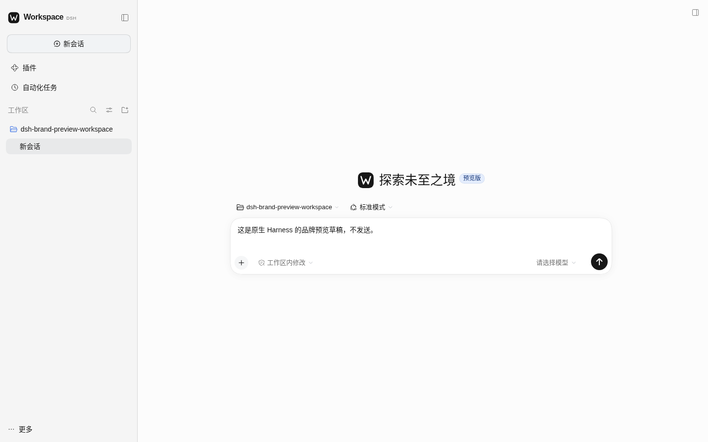
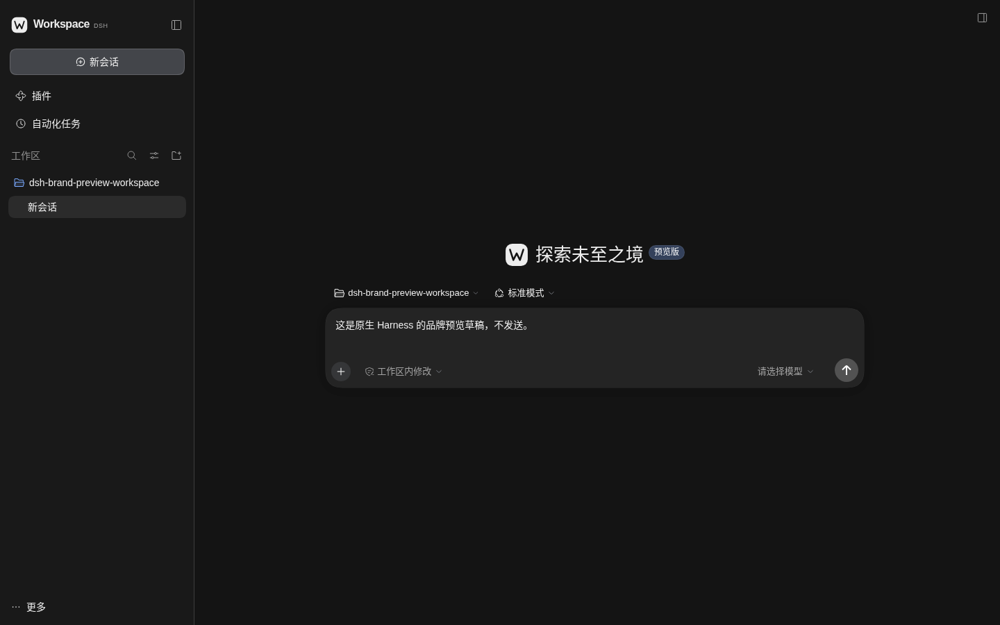
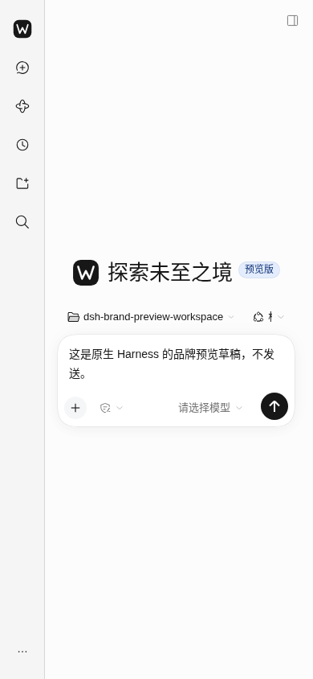
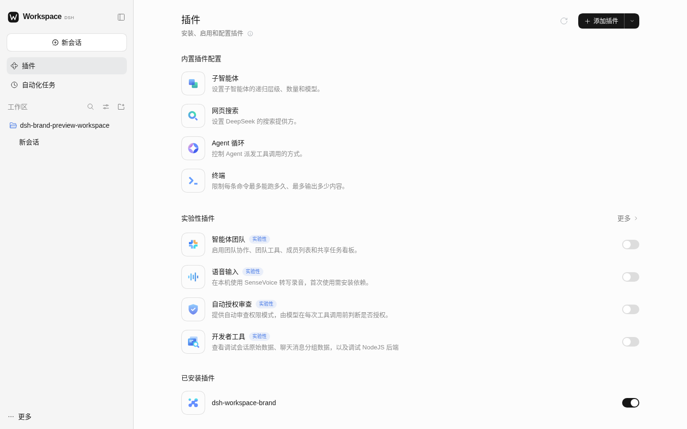
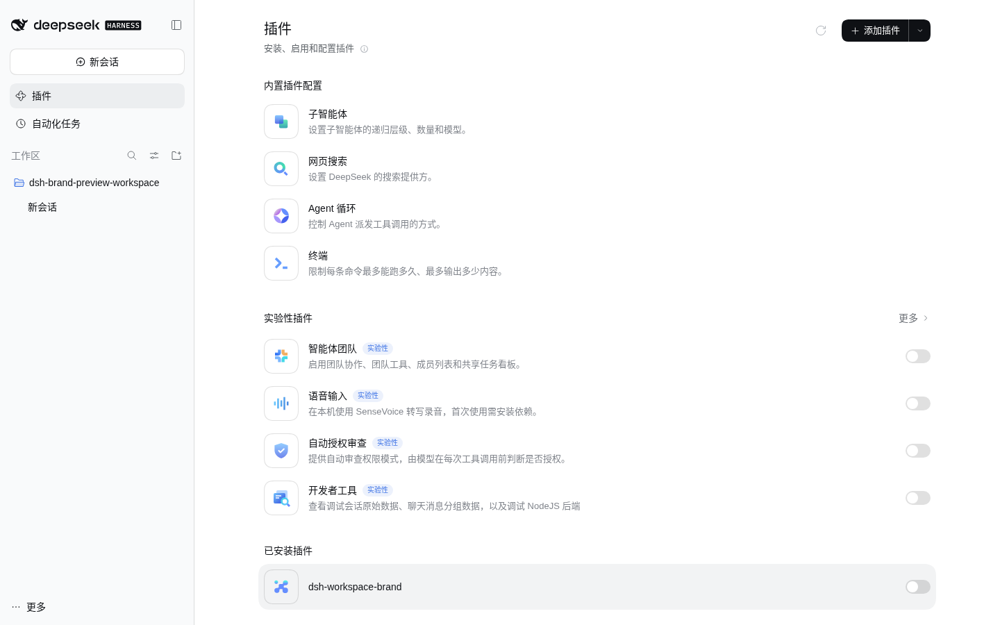

# 原生 Harness 品牌定制与预览

2026-10-27（中国标准时间）。本轮在官方 `dsh web` 内实现可选的 `dsh-workspace-brand` 插件：保留原生前端结构，通过品牌槽位与主题服务定制 Workspace 外观。

## 版本与运行边界

- 官方运行包：`@deepseek-ai/dsh@0.2.1-rc.2`。
- 接口参考：官方标签 `dsh-v0.2.1-rc.2`，提交 `687f282e8625c6b8d11ff58211a90524be2e4317`。
- 运行入口：官方 `dsh web`，预览只监听 `127.0.0.1:3080`。浏览器通过原生 Connection 换取会话，未取消认证。
- 独立预览使用 `/workspace/dsh-brand-preview-home` 和空的 `/workspace/dsh-brand-preview-workspace`；这不是用户原有实例，没有复制真实会话、附件或企业数据。
- 运行包与参考源码均在插件仓库之外，未修改官方源码。没有启动旧 Workspace/Muse 服务。

## 本轮外观

Workspace W 标识覆盖原生侧栏和新会话首页的品牌插槽。侧栏名称保留 DSH 标记，原生首页文案、预览版说明和浏览器标题保持宿主自身的表达。

浅色采用白色画布、浅灰侧栏与深色按钮；深色采用深灰分层画布和可读的中性色按钮。Send 的图标在原生实现中固定为白色，所以深色模式使用中灰填充，避免白字落在浅色填充上。错误、警告和成功等状态色不改。

外观通过 `ctx.theme.overrideTokens` 同时声明 light/dark 颜色。主题偏好、字号和字体仍归原生设置所有；标识通过 `sidebar.brand.mark`、`sidebar.brand.name`、`conversation.hero.brand.mark` 接入。没有替换会话、模型、权限、输入、工作区或插件管理逻辑。

## 实际截图

以下是本轮官方宿主的实际 Chromium 截图，桌面 1440×900、手机 390×844。输入框文字是未发送的验收草稿，工作区是空的测试目录。截图不含启动认证链接、凭据或真实企业资料。

### 浅色原生首页

### 深色原生首页

### 手机宽度

### 原生插件管理

### 停用后恢复官方外观

## 验证结果

- `npm run check`：构建／清单检查和核心测试通过，134/134、零跳过。新增 3 项验证品牌优先级、卸载恢复、保留其他主题层、等待槽位时的取消，以及 Host 不注册能力。
- `npm run test:client`：资料库、Space、经营记忆、询盘恢复、ERP 五个既有 Client 冒烟通过；使用合成数据与临时存储，部分既有用例仍有 React act 警告。这不替代原生浏览器检查。
- 实际 `dsh web` / Chromium：原生工作区选择、草稿输入、深色／浅色切换、切换后的草稿保留、原生插件页停用恢复与重新启用通过；浏览器 JavaScript 错误数为 0。
- 390px 宽度下，页面没有横向溢出；这不是完整手机或桌面客户端验收。
- 未发送草稿；观察到的原生 prompt 请求为 0。没有继承模型 Key，没有进行真实模型或 Worker 验收。
- 启停验证只操作独立预览 profile，没有修改用户原有 profile。默认安装到现有实例仍需通过原生插件管理器选择此目录。

这些当前外观验收截图仅用于设计审阅，位于 `docs/`，不进入插件的发布文件清单。运行数据、认证信息、完整日志及历史产物保留在 Git 外。

安装、卸载和修改品牌常量见 [插件说明](../integrations/dsh/dsh-workspace-brand/README.md)。
