# 原生 DSH 完整插件预览

2026-10-27（中国标准时间）。首轮品牌截图没有加载既有业务插件。本次在同一个官方 DSH 独立预览 profile 中安装并启用全部六个业务 bundle 与品牌插件，逐个打开真实界面截图。

这是 `@deepseek-ai/dsh@0.2.1-rc.2` 的原生 Web 前端。以下为 Chromium 实际截图；没有使用独立 Workspace/Muse 前端或模拟 API。预览使用空的测试工作区，不包含用户原有数据。

截图与检查使用 `agent/harness-20261023` 的 `cd0769ff` 代码，已同步该分支的 ERP 买手登记与订单录入更新。

## 插件入口

| 插件 | 版本 | 原生入口 | 本次状态 |
| --- | --- | --- | --- |
| `dsh-space-workspace` | 1.1.0 | 侧栏「空间」 | 已启用，页面打开正常 |
| `dsh-mini-erp` | 0.2.0 | 侧栏「ERP」 | 已启用，商品索引打开正常 |
| `dsh-workspace-library` | 1.2.0 | 侧栏「资料库」 | 已启用，产品库打开正常 |
| `dsh-workspace-memory` | 0.1.0 | 侧栏「经营记忆」 | 已启用，工作区及记忆筛选打开正常 |
| `dsh-inquiry-recovery` | 0.1.0 | 侧栏「询盘恢复」 | 已启用，导入入口及空列表打开正常 |
| `@local/dsh-sourcing-agent` | 1.0.0 | 新会话的模式选择器 → Sourcing Agent | 已启用，预设可见；包含七个按需 Skill |
| `dsh-workspace-brand` | 0.1.0 | 原生品牌槽位与主题服务 | 已启用，不增加业务面板 |

以上是既有插件的联合检查，未把这些业务 bundle 改成所有实例的默认必装组件。各业务面板沿用自身现有布局；品牌插件统一宿主标识、侧栏与基础主题，并未重写业务表单。

## 完整首页

左侧可以看到全部五个业务面板入口。

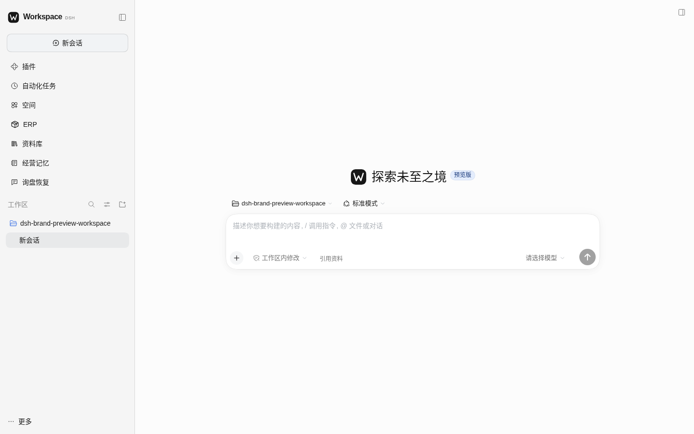

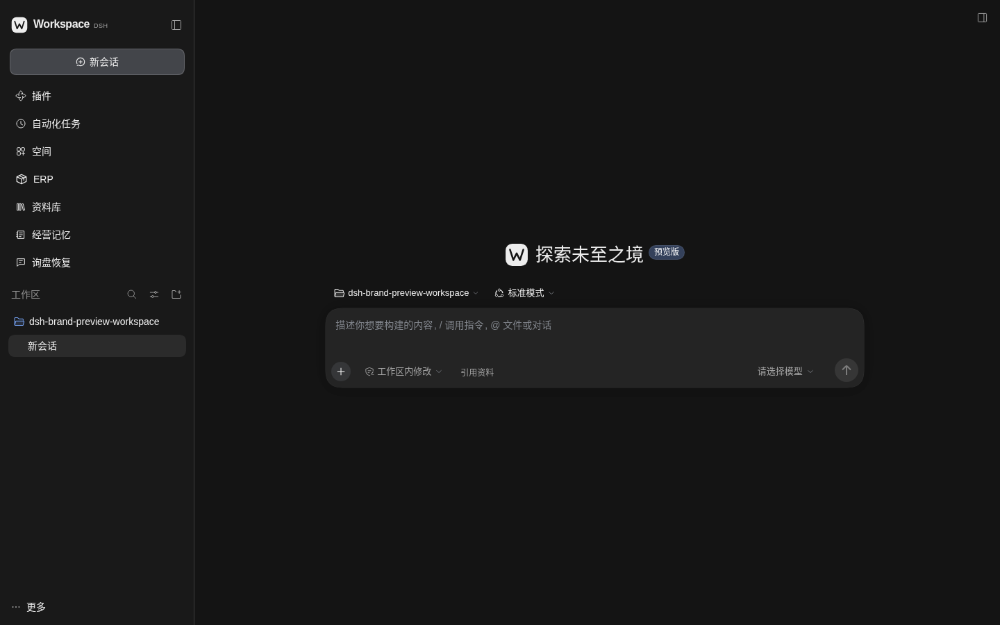

## 空间

空间预览明确配置 `seedDemo: false`，接口确认内容为空、`seeded: false`。页面上的「开始使用」是原有模板入口；未生成示例页面。

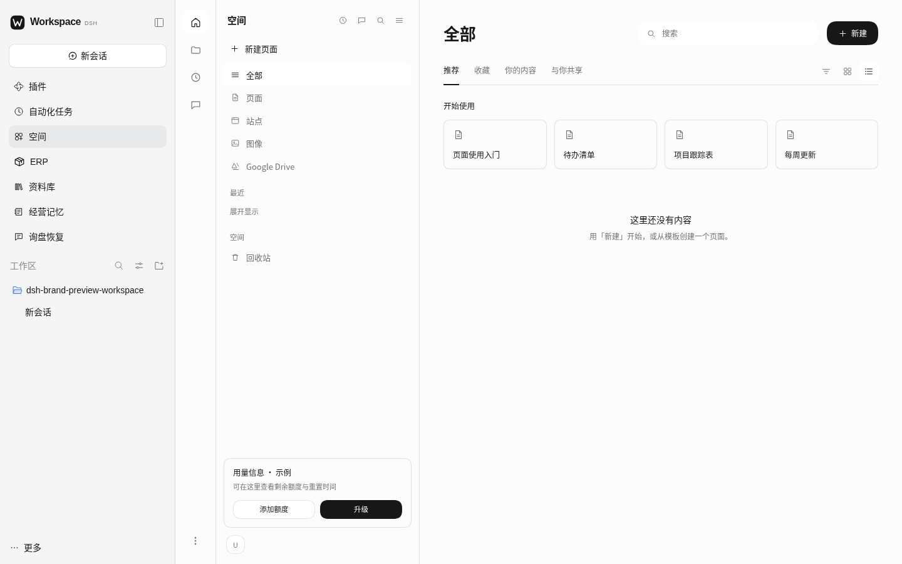

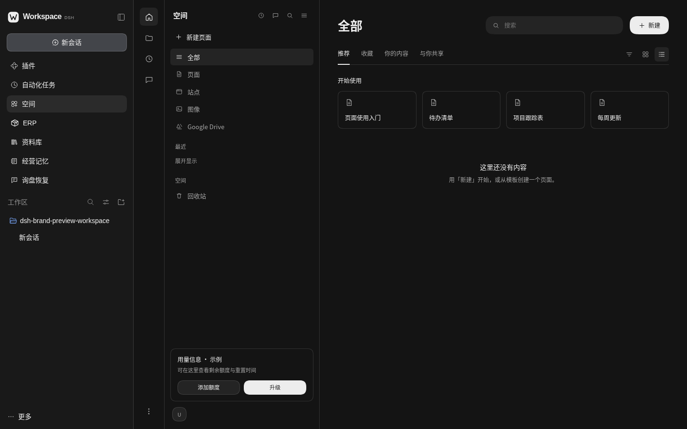

## ERP

保留既有经营后台、商品／买手／订单／供应名额导航及资料库复用入口。

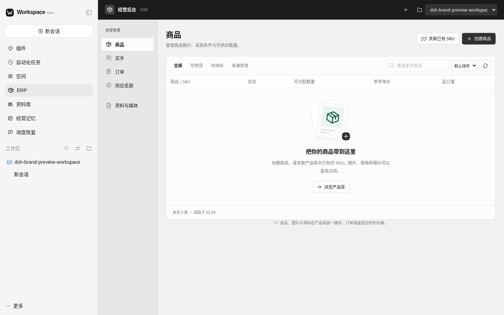

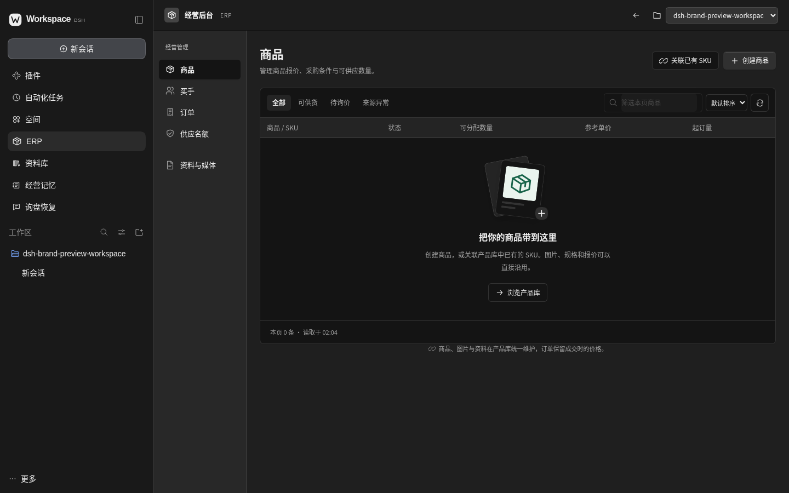

## 资料库

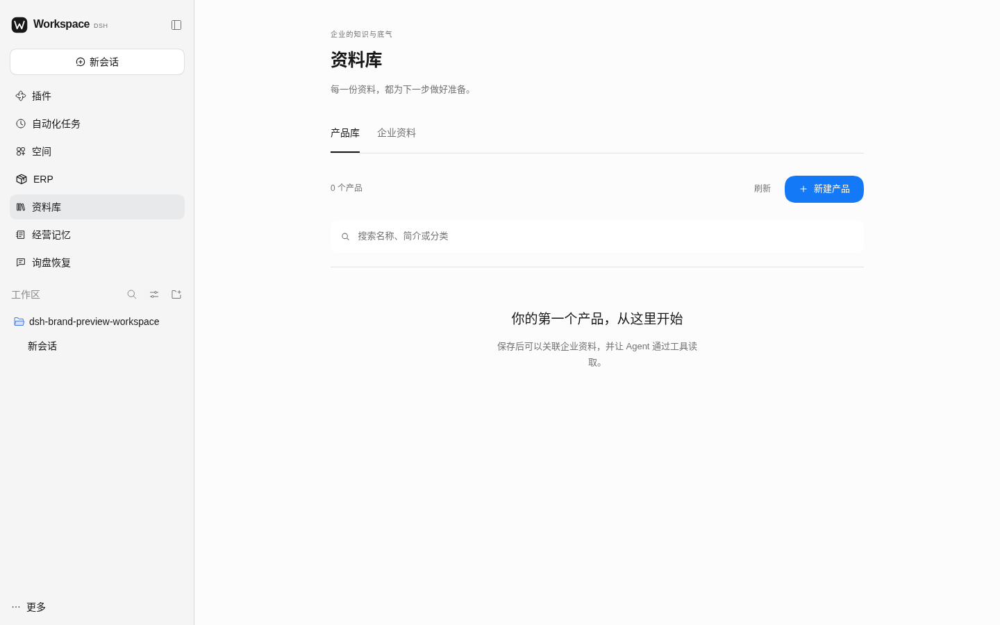

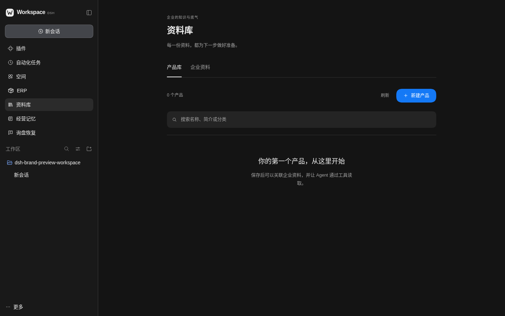

## 经营记忆

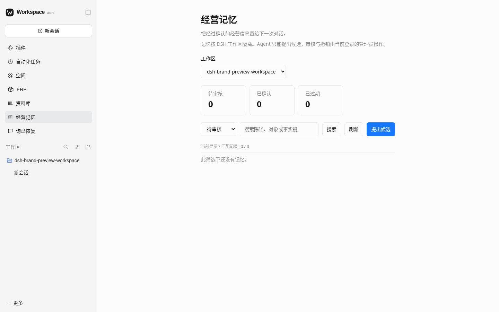

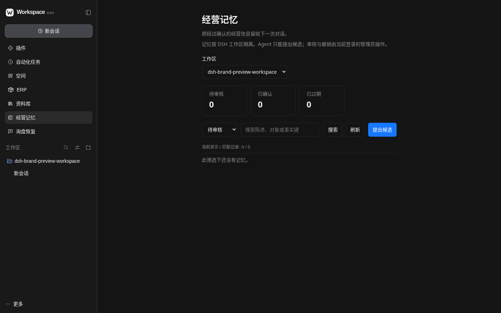

## 询盘恢复

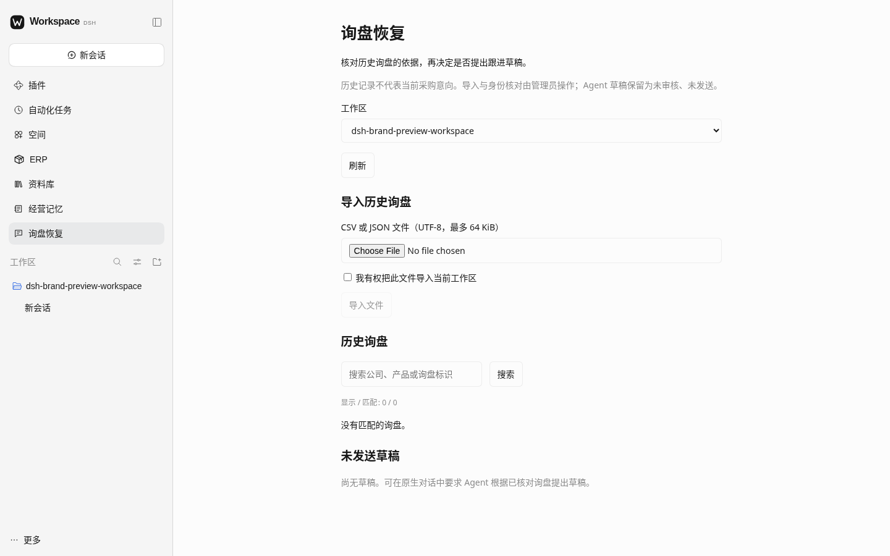

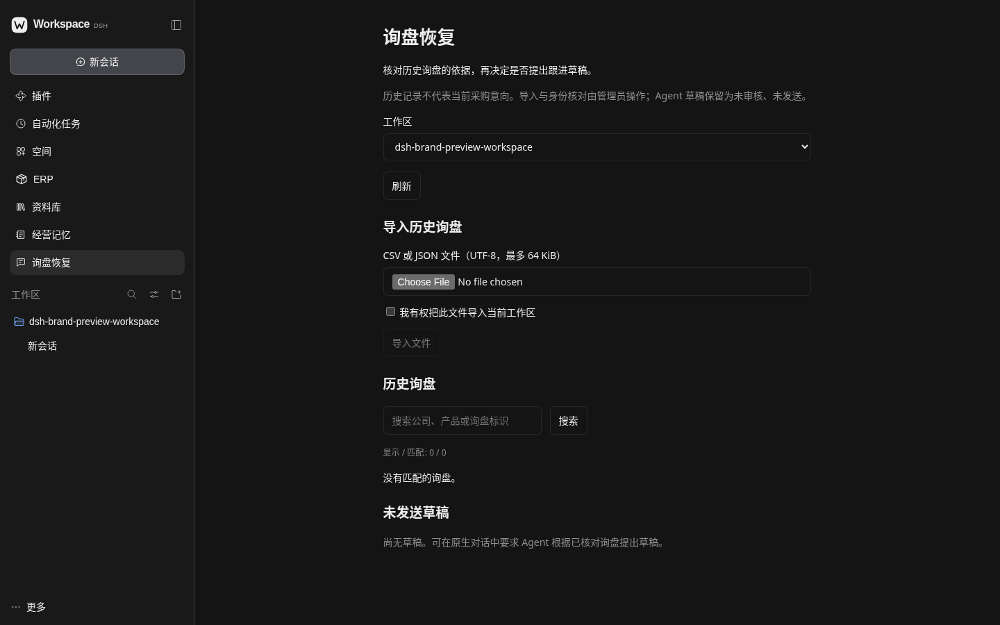

## Sourcing Agent

Sourcing 是原生 Agent 预设，不是另一个侧栏面板。模式选择器显示其名称与说明；本次没有执行该预设或调用模型。七个 Skill 为 sourcing、dtc-brand、export-supplier、market-evidence、opportunity-pack、long-term-mandate、buyer-magazine。

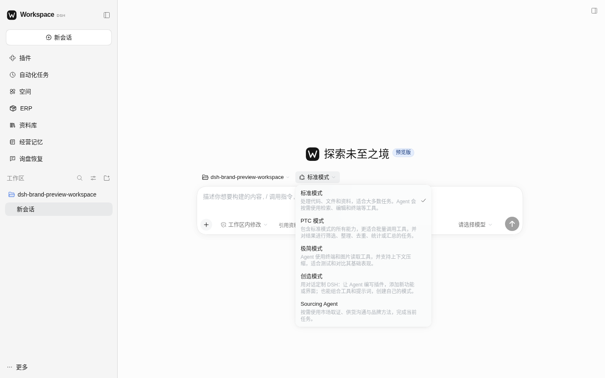

## 已安装插件

插件管理页滚动到已安装区域，七个本地 bundle 均处于 running 状态。

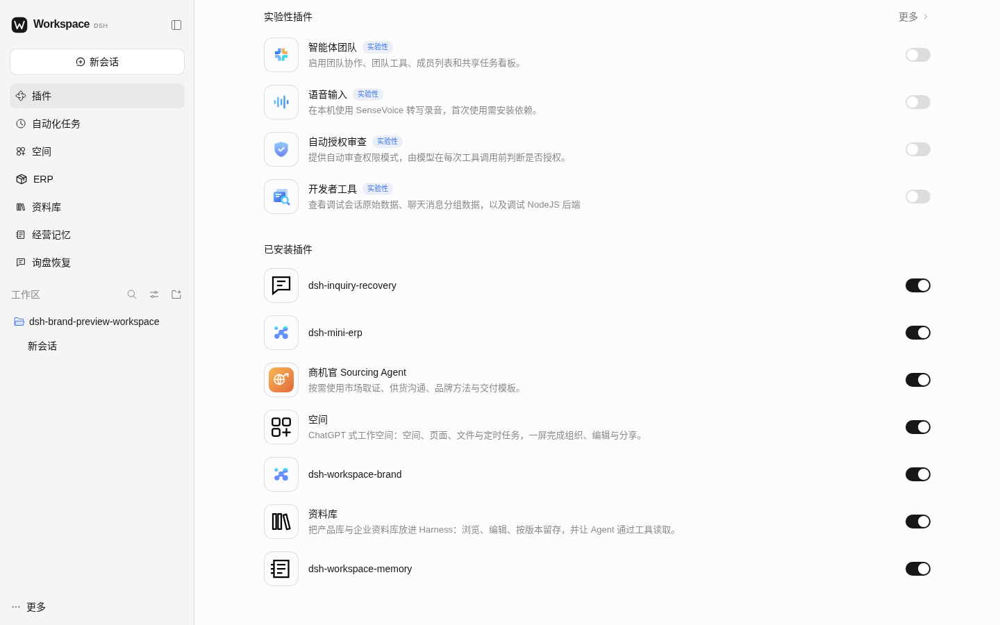

## 手机宽度

390×844 的完整首页无页面横向溢出；此项仅覆盖首页，没有进行各业务面板的完整手机验收。

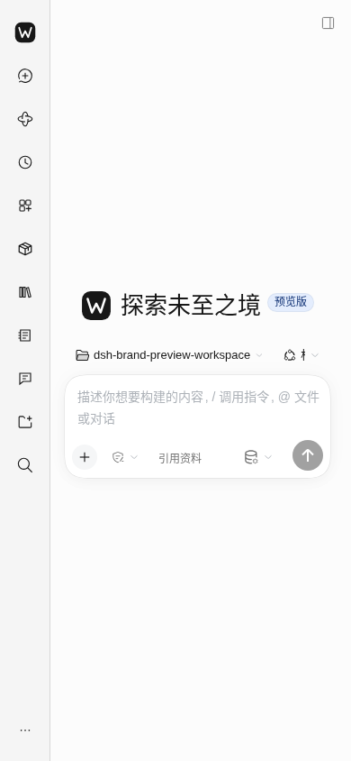

## 检查范围

- 五个业务面板分别在浅色、深色模式下打开，检查可见文本与实际截图；桌面页面无横向溢出。
- 真实认证会话访问 `/space-api/state`、`/mini-erp-api/workspaces`、`/workspace-library-api/state`、`/workspace-memory-api/workspaces`、`/inquiry-recovery-api/workspaces` 均返回 HTTP 200；没有会话的独立请求均返回 HTTP 401。
- 七个本地 bundle 在原生插件管理器中均为 running；Sourcing Agent 在原生模式列表可见。
- 本轮浏览器 JavaScript 错误为 0，观察到的原生 prompt 请求为 0。没有导入文件、创建业务记录或进行真实模型执行。
- 本轮仅补充预览安装、截图与说明，没有修改业务插件实现。同步上述分支更新后重新执行 `npm run check`，135/135 通过、零跳过；`npm run test:client` 五个既有 Client 冒烟通过。既有 DOM 用例仍输出 React act 与 Space 重复 key 警告，实际空工作区浏览器没有 JavaScript 错误。自动检查不代表完整业务验收，首轮品牌检查见 [品牌验收](DSH-NATIVE-BRAND.md)。

预览监听 `127.0.0.1:3080`，保留官方认证。独立 profile 位于 `/workspace/dsh-brand-preview-home`，测试工作区为 `/workspace/dsh-brand-preview-workspace`；用户原有 profile 和业务数据未更改。运行认证、会话与日志均不进入仓库。这些当前设计审阅截图位于 `docs/`，不进入插件发布文件清单。
