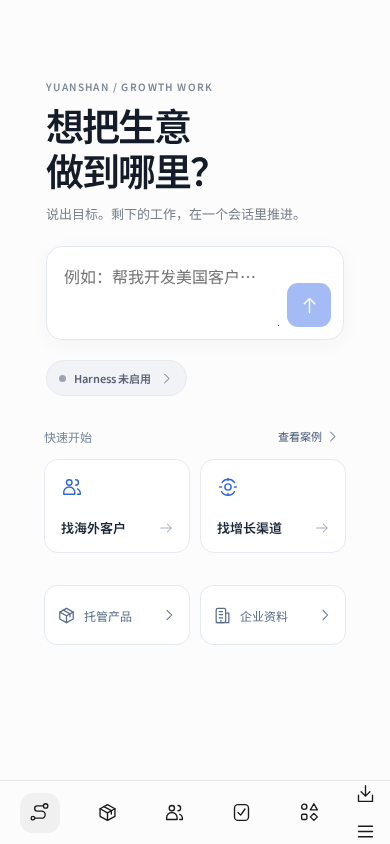
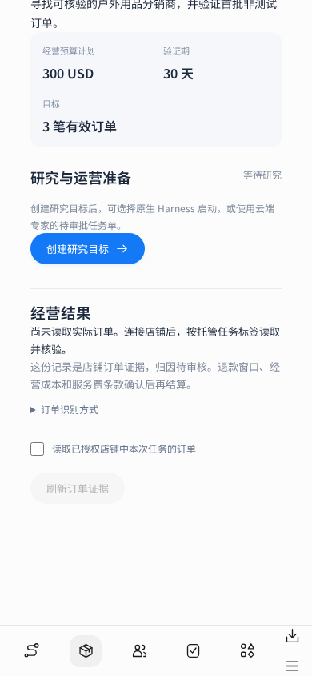
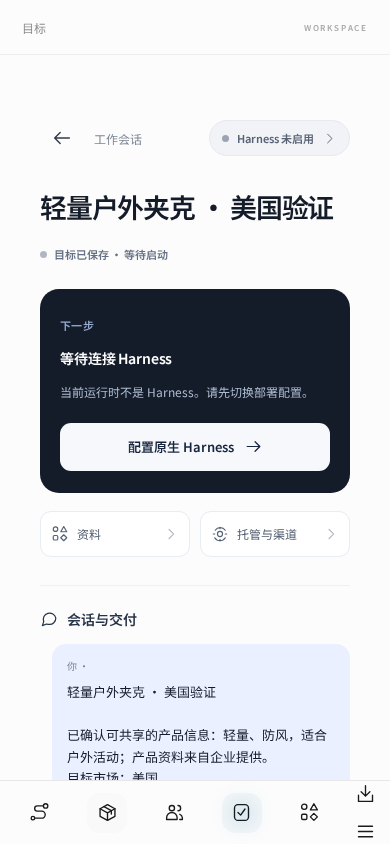

# Muse 工作会话与产品托管

这次开发把既有 Muse 移动端和企业两库接回主线运行时，并增加产品托管的持久流程。企业可以保存自有产品，确认可以交给 Agent 的介绍、目标市场、验证预算和订单目标，再创建一个真实的研究目标。未配置原生 Harness、云电脑或 Shopify 时，页面显示当前缺口，不生成模拟执行或经营成绩。

## 当前可操作的流程

| 入口 | 已实现的行为 |
| --- | --- |
| `/` | Muse 工作首页、目标草稿、真实最近工作、实际 Harness 配置状态 |
| `/goals/:id` | 目标会话、运行与交付记录、准确审批入口、资料关联和高级目标设置 |
| `/library/products` | 产品草稿、SKU、供货条件、固定版本资料、发布准备检查 |
| `/library/company` | 企业档案、内部文件、证书版本和管理员审核 |
| `/commerce` | 托管任务列表、企业产品选择、市场和验证范围确认 |
| `/commerce/:id` | 创建研究目标、Shopify 标签订单证据、分页进度和净收款 |
| `/workers` | 原有八类云端专家、团队、已登记 Worker 和配置后的 Dot 桥接 |
| `/chat` | 原有会话、执行审批、文件产物与工具回执 |

未保存输入有离开提示。未知提交结果保留原请求 ID 和内容，重试不会另建产品、托管任务或研究目标。研究目标先保存为草稿；创建目标不启动模型。产品版本在托管时固定，后续编辑产品不会静默修改已确认范围。

## 两库的数据与模型边界

两库保存在 schema 3。v1/v2 工作区升级前会保留原始字节备份，Worker、专家、Dot 与已有扩展数据继续保留。恢复流程可以识别旧版备份，内部文件仍保留文件版本与 SHA-256 校验。

关联企业资料不会自动把内部文档、产品价格表或私有文件传给模型、通用连接器和外部 Worker。产品托管表单有单独的「可以共享给 Agent 的产品介绍」，企业明确确认后，只有该介绍和本次经营范围进入研究目标。Shopify 凭证始终只在服务器环境中读取。

## Shopify 连接和订单证据

服务器部署者通过授权的秘密管理配置：

```text
WORKSPACE_SHOPIFY_SHOP_DOMAIN=your-shop.myshopify.com
WORKSPACE_SHOPIFY_ADMIN_TOKEN=<authorized Admin API token>
```

域名必须是本店准确的小写 `myshopify.com` 域名，不接受任意 URL、IP、路径或浏览器提供的地址。API 固定为 `2026-10`，使用 HTTPS、禁止跳转、10 秒超时和响应大小上限。浏览器不采集凭证，工作区存储不保存凭证。

「已配置」只表示服务器有配置；管理员点击验证后，实际读取店铺身份和应用权限才显示「已验证授权」。验证观察在进程重启后失效，失败的重新验证也会清除旧观察。读取订单需要 `read_orders` 或已有 `write_orders` 授权；本实现只发读取查询。超过普通 60 天订单历史窗口时还必须有 `read_all_orders`，否则拒绝把受限历史显示成完整结果。

订单必须带有 `workspace-project-<托管任务 UUID>` 标签，并且创建时间不早于该任务。标签仍须人工审核归因。每页最多 50 笔，每轮最多保存 1,000 笔；未读完时明确显示部分结果。相同读取请求 ID 的重试不会推进游标。已完成一轮后，刷新从第一页重建当前证据，避免后来退款仍保留旧金额。

有效销售证据同时要求：非测试、未取消、财务状态为已收款或部分退款、履约状态为已履约，并且收款减退款大于零。金额用整数微单位计算，同币种相加，币种之间不做隐含换算。订单读取不包含买家姓名、地址或邮箱。接口异常不会把旧证据覆盖成零销售。

这不是结算金额。成本、退款观察期、归因规则和服务费条款尚未实现，`billableAmount` 保持 `null`，不自动扣费。

| 接口 | 权限与用途 |
| --- | --- |
| `GET /api/commerce-status` | 登录后读取真实配置状态 |
| `GET /api/commerce-projects[/id]` | 登录后读取已保存任务 |
| `POST /api/commerce-projects` | 管理员或操作员确认并保存范围 |
| `POST /api/commerce-projects/:id/stage-research` | 管理员或操作员创建一个草稿目标 |
| `POST /api/commerce-shopify/verify` | 管理员验证真实店铺身份和权限 |
| `POST /api/commerce-projects/:id/sync-orders` | 管理员确认并读取一页本任务订单 |

企业访问模式沿用现有身份、会话与 CSRF 校验。只读成员不能写入，操作员不能验证店铺或读取授权订单。

## 距离自动经营闭环还需要什么

| 能力 | 当前状态 | 下一阶段交付 |
| --- | --- | --- |
| DeepSeek Harness / Agent Runtime | 原有真实 SDK 适配保留，Muse 根据配置拦截启动 | 在目标主机打包原生 CLI、配置执行档案，完成真实运行和工具回执验收 |
| 云电脑 | 尚无云电脑创建、控制和会话恢复服务 | 接入实际远程执行环境与授权账户，绑定持久任务和日志 |
| 海外分销 | 可以创建有来源要求的研究目标和云专家任务单 | 实际检索、候选客户核验、经授权的联系与询盘闭环 |
| Shopify 上架与履约 | 店铺验证和只读订单证据已实现 | 产品草稿、准确发布审批、库存/履约服务接入和幂等写操作 |
| 按经营结果付费 | 订单证据与归因状态可见 | 确认收入/毛利基准、成本、退款窗口、归因和费率，再实现账单 |

Shopify 店铺平台由 Shopify 托管。远程服务器部署的是 Agent Runtime、云电脑会话及 Shopify 应用/连接器；如使用独立店面，前端也可以另行托管。当前没有把 Shopify 平台部署到本项目服务器，也没有真实店铺发布或履约写操作。

## 本地验证

```sh
npm ci
npm run build
npm test
node --test test/ui.dom.test.mjs
npm run test:commerce
npx playwright install chromium
npm run test:muse:browser
```

浏览器验收使用生产构建、真实本地 HTTP 和持久存储，模型保持未配置，Shopify 保持未连接。截图里的企业与产品是明确的本地测试数据。Shopify 协议测试注入合成响应，覆盖店铺权限、分页和重试、退款、错误响应、店铺变更及恢复；这些测试不代表生产 Shopify 已接通。

Linux 验收机没有中文字体时，可用 `QA_FONT_DIR` 指向本机安装的 `@fontsource/noto-sans-sc` 包，测试通过本地拦截加载字体；这不是应用依赖。`CHROMIUM_PATH` 可指定本机浏览器。默认使用浏览器沙箱；隔离测试环境可用 `CHROMIUM_NO_SANDBOX=1` 显式关闭。

本轮正式构建通过；后端 349 项测试中 343 通过、6 项原生构建相关测试跳过、0 失败；DOM 与真实 HTTP 的 19 项回归全部通过；实际 Chromium 浏览器的 9 项流程检查通过。原生构建的跳过项与真实部署仍需单独验收。

浏览器结果见 [VERIFICATION.json](screenshots/muse-commerce/VERIFICATION.json)，界面如下：





Shopify 官方接口依据：[订单查询](https://shopify.dev/docs/api/admin-graphql/2026-10/queries/orders)、[Order 字段与权限](https://shopify.dev/docs/api/admin-graphql/2026-10/objects/Order)、[当前应用授权](https://shopify.dev/docs/api/admin-graphql/2026-10/queries/currentAppInstallation)。
