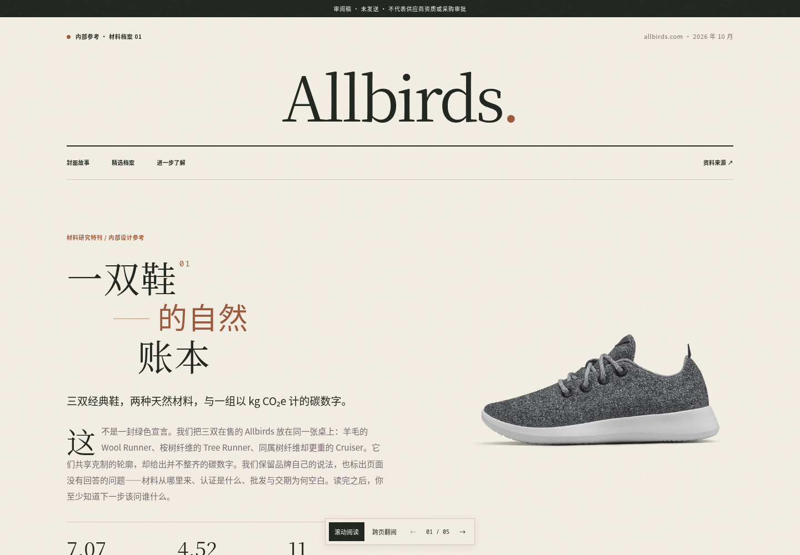
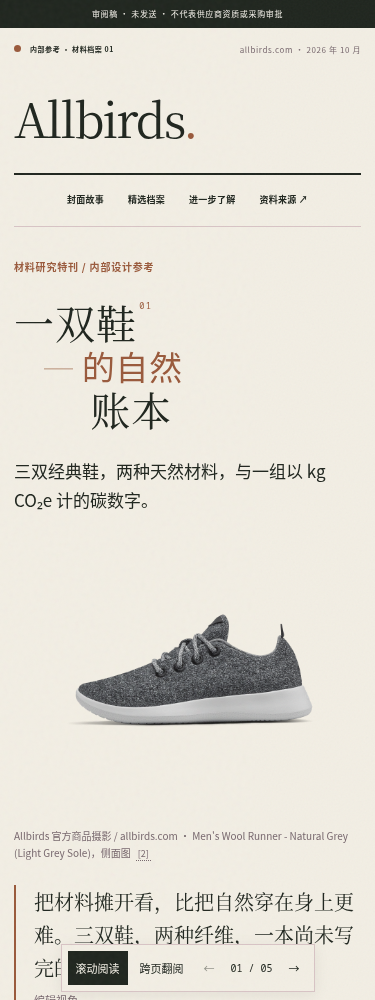

# Allbirds 材料研究特刊 · 四技能包真实验收

由 `dsh-buyer-magazine@0.3.0` 在 DeepSeek Harness 原生会话中根据 Allbirds 网址完成研究、设计、生成与图片审阅。包含真实商品摄影、五跨页、滚动/翻页、材料研究台、描图注记、品牌 vCard 与官方联系链接。

**[下载整套文件（ZIP）](Allbirds-editorial-deliverables.zip?raw=true)** · [7 页 PDF](Allbirds-editorial.pdf) · [下载交互 HTML](Allbirds-editorial.html?raw=true)

HTML 下载后用浏览器打开；商品图片引用原站 CDN，需要网络。PDF 包含实际渲染图片，可离线阅读。长跨页允许纵向滚动；翻页模式每次展示一个跨页。

这是第三方品牌的内部设计验收样刊，使用原站商品图并保留来源；不是 Allbirds 官方出版物，不主张商用图片授权。未发布网站、发送线索或执行交易。用户自己提供且声明已授权的网站按其声明另行制作。

## 真实验证

- 原生模型实际调用四个用户技能，读取官网与商品 JSON，构建 issue；没有提交预制样稿冒充自主生成。
- 模型看图后调整照片、文案与配色；验收期间修复了模板图片高度、手机主图顺序、打印展开内容、来源附录及三栏书脊冲突。
- 375/768/1440 宽度无页面横向溢出、图片加载成功；翻页、键盘、材料切换、描图注记、vCard 和实际行动入口通过浏览器检查。
- 手机五跨页、桌面翻页与 7 页 PDF 均有实际图片审阅。最终小改动复查了受影响的末两跨页和 PDF 第 4–6 页，范围和版本保留在 [验收数据](acceptance.json)。
- 最终 HTML 与同一 [issue 输入](issue.json) 的规范编译结果逐字节一致，未手改产物。
- 仓库检查 229 项通过；官方 SDK、四技能发现及末页 Chromium 回归通过。这里是一个真实网站样本，不代表所有网站都能无条件成功。

HTML SHA-256：`a251819ad0a8a2d0a68b951ea88dcc5432e026d02da673f49602ec838a620868`。

## 桌面

## 手机

插件说明见 [README](../../../integrations/dsh/dsh-buyer-magazine/README.md)，技能接入与调试过程见 [工程验收记录](../../DSH-EDITORIAL-SKILL-PACK.md)。FastAI、Apify、VIP 核验与 CRM 后端未配置；当前路径使用原生网页采集、真实原站图片与本地/官方链接交互。
